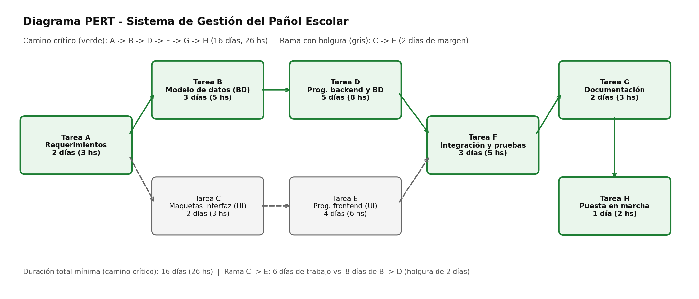
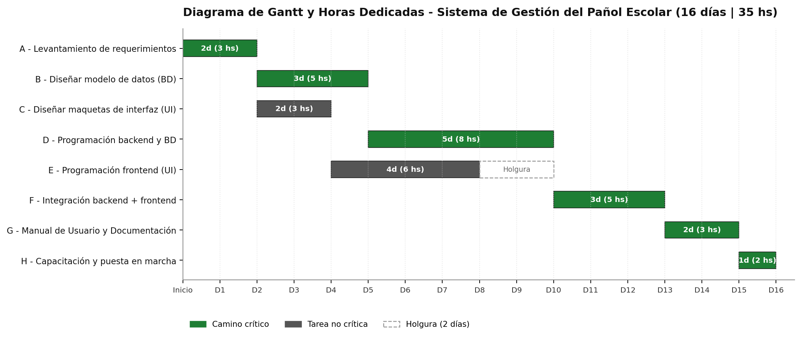
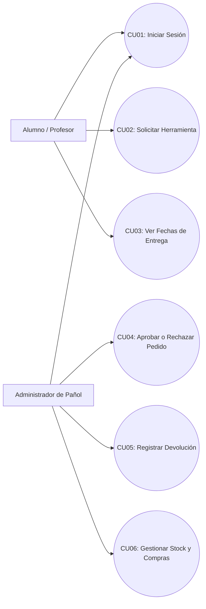
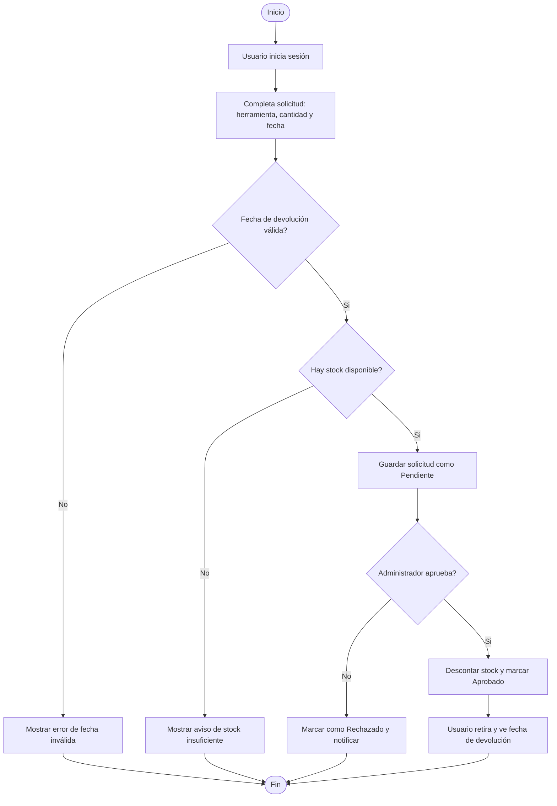
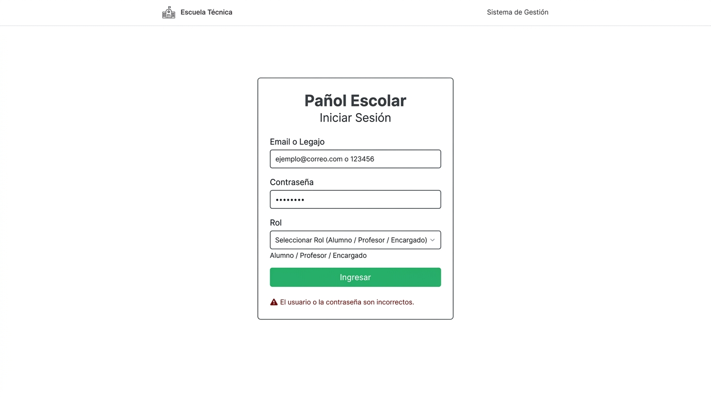
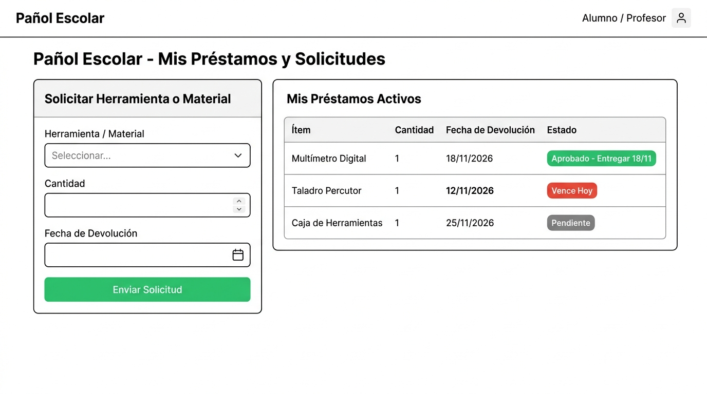
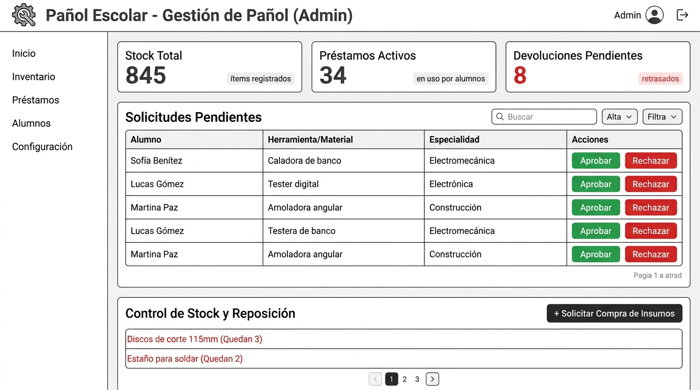

# Documentación Completa del Proyecto de Software

**Sistema de Gestión de Préstamos de Pañol Escolar**

---

## 0. Marco Conceptual y Clasificación (Introducción)

### Diferencia entre Documentación de Usuario y Documentación Técnica

* **Documentación de Usuario (Manual de Usuario):** Está dirigida a los usuarios finales (alumnos, profesores y encargado del pañol). Utiliza técnicas de documentación no técnica, como guías paso a paso y capturas de pantalla, con lenguaje claro para explicar cómo operar el sistema en tareas diarias.
* **Documentación Técnica (de Sistema):** Está dirigida a desarrolladores y personal de mantenimiento. Utiliza técnicas de documentación técnica, como diagramas de flujo, casos de uso y modelos de datos, con lenguaje preciso para detallar la arquitectura, la base de datos y la configuración del software.

### Clasificación de Elementos

* **a) Manual de configuración de cadenas de conexión a la Base de Datos y despliegue del servidor:** Corresponde a **Documentación Técnica**, porque describe parámetros internos de infraestructura, credenciales y puesta en marcha destinados al equipo técnico.
* **b) Guía rápida en PDF sobre cómo solicitar el préstamo de una herramienta desde la app:** Corresponde a **Documentación de Usuario**, porque orienta al usuario final mediante instrucciones simples para completar una tarea en la interfaz.

---

## 1. Documentación de Relevamiento y Análisis

### 1.1 Descripción del Problema

En el pañol escolar, el registro de préstamos de herramientas, fechas de devolución y faltantes de insumos suele realizarse en planillas de papel. Esta modalidad genera demoras al momento de entregar materiales, dificultad para detectar devoluciones vencidas y falta de control actualizado sobre el stock disponible.

### 1.2 Solución Propuesta

Se propone un sistema web cliente/servidor para administrar el pañol escolar. Los alumnos y profesores pueden solicitar herramientas o materiales y consultar cuándo deben devolverlos, mientras que el encargado del pañol gestiona el stock, aprueba o rechaza pedidos, controla devoluciones pendientes y solicita compras para reponer insumos.

### 1.3 Requerimientos Funcionales (RF)

| Código | Requerimiento | Descripción |
| :--- | :--- | :--- |
| RF01 | Registro de Usuarios y Roles | El sistema debe permitir la autenticación y gestión de permisos para tres roles definidos: Alumno, Profesor y Administrador (Encargado de Pañol). |
| RF02 | Solicitud de Herramientas y Materiales | Los alumnos y profesores pueden buscar herramientas o insumos disponibles, indicar la cantidad requerida, definir una fecha estimada de devolución y enviar la solicitud. |
| RF03 | Gestión de Préstamos y Aprobaciones | El administrador puede visualizar las solicitudes pendientes, aprobarlas o rechazarlas según disponibilidad de stock y registrar la entrega o devolución del material. |
| RF04 | Control de Stock y Reposición | El sistema descuenta automáticamente las unidades al aprobar un préstamo, alerta sobre niveles mínimos de stock y permite al administrador generar solicitudes de compra para reponer insumos. |
| RF05 | Seguimiento de Vencimientos | Los usuarios visualizan sus préstamos activos y fechas de entrega, mientras que el administrador consulta los préstamos próximos a vencer o atrasados. |

### 1.4 Requerimientos No Funcionales (RNF)

| Código | Categoría | Especificación Técnica |
| :--- | :--- | :--- |
| RNF01 | Seguridad | Autenticación basada en tokens JWT con expiración de 8 horas. Contraseñas encriptadas mediante algoritmo BCrypt y comunicación protegida bajo protocolo HTTPS. |
| RNF02 | Disponibilidad y Rendimiento | Tiempo de respuesta promedio menor a 2 segundos en consultas de inventario y registro de préstamos. Disponibilidad del 99.5% durante el horario escolar. |
| RNF03 | Usabilidad | Interfaz web simple con estados visuales diferenciados por color (verde para disponible o aprobado, rojo para vencido o stock bajo). |

### 1.5 Historias de Usuario (User Stories)

* **HU01 - Alumno / Profesor:** Como alumno o profesor, quiero solicitar herramientas o materiales desde el sistema y ver la fecha límite de devolución para organizar mis prácticas de taller sin demoras.
  * **Criterios de Aceptación:**
    1. El sistema valida que la cantidad solicitada sea mayor a cero y menor o igual al stock disponible.
    2. La solicitud queda registrada en estado "Pendiente" y visible en la tabla de préstamos activos.
* **HU02 - Administrador (Pañolero):** Como encargado del pañol, quiero aprobar o rechazar solicitudes, controlar qué herramientas faltan devolver y pedir reposición de insumos cuando el stock es bajo para mantener el inventario ordenado.
  * **Criterios de Aceptación:**
    1. Al presionar "Aprobar", el estado cambia a "Aprobado" y se descuenta el stock en la base de datos.
    2. Los ítems con stock menor al mínimo se resaltan en rojo y permiten generar una solicitud de compra.

### 1.6 Planificación del Proyecto (PERT y Gantt)

| ID | Tarea / Actividad | Predecesora | Duración | Horas dedicadas |
| :--- | :--- | :--- | :--- | :--- |
| A | Levantamiento de requerimientos y entrevistas | Ninguna | 2 días | 3 hs |
| B | Diseñar el modelo de datos (Base de Datos) | A | 3 días | 5 hs |
| C | Diseñar las maquetas de interfaz de usuario (UI) | A | 2 días | 3 hs |
| D | Programación del backend y base de datos | B | 5 días | 8 hs |
| E | Programación del frontend (interfaces de usuario) | C | 4 días | 6 hs |
| F | Integración de backend + frontend y pruebas | D, E | 3 días | 5 hs |
| G | Redacción del Manual de Usuario y Documentación | F | 2 días | 3 hs |
| H | Capacitación al personal y puesta en marcha | G | 1 día | 2 hs |

* **Camino crítico (PERT):** `A -> B -> D -> F -> G -> H`, con una duración mínima total de **16 días** (26 horas en ruta crítica) y **35 horas totales** de equipo. La rama `C -> E` cuenta con una holgura de **2 días**.





---

## 2. Documentación de Diseño

### 2.1 Diagrama de Casos de Uso (UML)

**Actores Principales:**

* **Alumno / Profesor:** Inicia sesión, consulta el catálogo de herramientas, realiza solicitudes de préstamo y revisa sus fechas de devolución.
* **Administrador (Encargado de Pañol):** Gestiona el inventario, aprueba o rechaza pedidos, registra devoluciones, controla retrasos y genera pedidos de compra para reposición.



### 2.2 Especificación Formal de Caso de Uso (CU02: Solicitar Herramienta o Material)

* **Actor Principal:** Alumno o Profesor.
* **Precondición:** El usuario debe haber iniciado sesión con una cuenta activa y no registrar herramientas vencidas sin devolver.
* **Flujo Principal:**
  1. El usuario accede a la sección "Solicitar Herramienta o Material" en su panel.
  2. Selecciona el ítem deseado de la lista desplegable.
  3. Ingresa la cantidad requerida y elige la fecha de devolución en el calendario.
  4. Presiona el botón "Enviar Solicitud".
  5. El sistema verifica que haya stock disponible, registra el pedido en estado "Pendiente" y lo muestra en la tabla "Mis Préstamos Activos".
* **Flujos Alternativos / Excepciones:**
  * **A1 (Stock insuficiente):** Si la cantidad solicitada supera el stock disponible, el sistema cancela el envío y muestra un mensaje en rojo indicando la cantidad máxima disponible.
  * **A2 (Fecha inválida):** Si el usuario selecciona una fecha de devolución anterior al día actual, el sistema bloquea el registro y solicita corregir la fecha.

### 2.3 Diagrama de Flujo del Proceso (Solicitud y Validación de Préstamo)



### 2.4 Modelo Entidad-Relación (DER)

* **Usuario:** `id` (PK, INT), `nombre` (VARCHAR 100), `legajo_email` (VARCHAR 150, Unique), `password` (VARCHAR 255), `rol` (ENUM: 'ADMIN', 'PROFESOR', 'ALUMNO')
* **Herramienta:** `id` (PK, INT), `nombre` (VARCHAR 100), `categoria` (ENUM: 'HERRAMIENTA', 'MATERIAL'), `stock_actual` (INT), `stock_minimo` (INT), `estado` (ENUM: 'DISPONIBLE', 'BAJO_STOCK', 'SIN_STOCK')
* **Prestamo:** `id` (PK, INT), `usuario_id` (FK -> Usuario.id), `herramienta_id` (FK -> Herramienta.id), `cantidad` (INT), `fecha_solicitud` (TIMESTAMP), `fecha_devolucion_estimada` (DATE), `fecha_devolucion_real` (DATE, Nullable), `estado` (ENUM: 'PENDIENTE', 'APROBADO', 'RECHAZADO', 'DEVUELTO', 'VENCIDO')
* **SolicitudCompra:** `id` (PK, INT), `herramienta_id` (FK -> Herramienta.id), `admin_id` (FK -> Usuario.id), `cantidad_solicitada` (INT), `fecha_pedido` (TIMESTAMP), `estado` (ENUM: 'PENDIENTE', 'COMPRADO')

### 2.5 Prototipos de Pantalla y Capturas Anotadas (UX/UI)

* **Pantalla 1: Inicio de Sesión (`img/01_login.jpg`)**
  1. **Campo Email o Legajo:** Ingreso de credencial institucional del usuario.
  2. **Campo Contraseña:** Ingreso de clave personal oculta.
  3. **Selector de Rol:** Permite elegir entre Alumno, Profesor o Encargado.
  4. **Botón Ingresar (Verde):** Valida credenciales y redirige al panel correspondiente.
  5. **Mensaje de Error (Rojo):** Alerta visual cuando el usuario o la contraseña son incorrectos.
  

* **Pantalla 2: Panel de Usuario (`img/02_panel_usuario.jpg`)**
  1. **Selector de Herramienta / Material:** Lista desplegable para elegir el ítem del pañol.
  2. **Campo Cantidad y Fecha de Devolución:** Controles para indicar unidades y día límite de entrega.
  3. **Botón Enviar Solicitud (Verde):** Registra el pedido para revisión del encargado.
  4. **Tabla Mis Préstamos Activos:** Muestra ítems solicitados, fechas y etiquetas de estado (verde para Aprobado, rojo para Vence Hoy, gris para Pendiente).
  

* **Pantalla 3: Panel de Administrador (`img/03_panel_admin.jpg`)**
  1. **Tarjetas de Resumen:** Muestran Stock Total, Préstamos Activos y Devoluciones Pendientes (en rojo).
  2. **Tabla Solicitudes Pendientes:** Lista los pedidos con nombre del alumno, herramienta y botones de acción en verde (**Aprobar**) y rojo (**Rechazar**).
  3. **Control de Stock y Reposición:** Enumera en rojo los insumos con bajo stock e incluye el botón **Solicitar Compra de Insumos**.
  

---

## 3. Manual Técnico (de Sistema)

### 3.1 Arquitectura del Sistema

El sistema utiliza una arquitectura Cliente-Servidor desacoplada:

* **Frontend:** Desarrollado con HTML5, CSS3 y React.js mediante componentes para las vistas de usuario y administrador.
* **Backend:** API RESTful construida con Node.js y Express, encargada de las validaciones de stock, reglas de préstamos y control de sesiones.
* **Base de Datos:** Motor relacional PostgreSQL para garantizar la integridad referencial entre usuarios, herramientas y préstamos.

### 3.2 Diccionario de Datos (Tabla Principal: `prestamos`)

| Campo | Tipo | Nulo | Clave | Valor Defecto | Descripción |
| :--- | :--- | :--- | :--- | :--- | :--- |
| `id` | INT | No | PK | Autoincrement | Identificador único del préstamo. |
| `usuario_id` | INT | No | FK | - | Referencia al usuario solicitante. |
| `herramienta_id` | INT | No | FK | - | Referencia a la herramienta o material pedido. |
| `cantidad` | INT | No | - | 1 | Cantidad de unidades solicitadas. |
| `fecha_solicitud` | TIMESTAMP | No | - | CURRENT_TIMESTAMP | Fecha y hora de creación del pedido. |
| `fecha_devolucion_estimada` | DATE | No | - | - | Fecha límite informada para devolver el ítem. |
| `fecha_devolucion_real` | DATE | Sí | - | NULL | Fecha efectiva en que se devolvió al pañol. |
| `estado` | VARCHAR(20) | No | - | "PENDIENTE" | Estado actual (PENDIENTE, APROBADO, RECHAZADO, DEVUELTO, VENCIDO). |

### 3.3 Estructura de Módulos

```text
src/
├── auth/        # Inicio de sesión, generación y validación de tokens JWT
├── inventory/   # Alta, baja, modificación y consulta de herramientas y stock
├── loans/       # Registro de solicitudes, aprobaciones, rechazos y devoluciones
└── purchases/   # Generación y seguimiento de solicitudes de compra de insumos
```

### 3.4 Instalación y Configuración

**Requisitos Previos:** Node.js v18+, PostgreSQL 14+ y Git.

1. Clonar el repositorio: `git clone https://github.com/usuario/panol-escolar.git`
2. Instalar dependencias: `npm install`
3. Configurar variables de entorno en `.env` (`PORT=3000`, `DATABASE_URL`, `JWT_SECRET`).
4. Ejecutar migraciones: `npm run migrate`
5. Iniciar el servidor: `npm start`

---

## 4. Manual de Usuario

### 4.1 Introducción y Primeros Pasos

Esta guía explica cómo usar el Sistema de Gestión de Préstamos de Pañol Escolar. Para ingresar, abra la dirección web en el navegador, escriba su correo o legajo, ingrese su contraseña, seleccione su rol y presione **Ingresar**.

### 4.2 Documentación Paso a Paso: Solicitar una Herramienta o Material

* **1. Tarea:** Registrar una solicitud de préstamo de herramienta o material.
* **2. Objetivo:** Enviar un pedido formal al encargado del pañol dejando registrada la cantidad y la fecha de devolución.
* **3. Prerrequisitos:** El alumno o profesor debe tener un usuario activo en el sistema y la herramienta debe contar con stock disponible.
* **4. Pasos Numerados:**
  1. Ingrese al sistema y ubique el bloque izquierdo **Solicitar Herramienta o Material**.
  2. Despliegue el selector **Herramienta / Material** y elija el elemento necesario.
  3. Escriba la **Cantidad** requerida y seleccione la **Fecha de Devolución** en el calendario.
  4. Presione el botón verde **Enviar Solicitud**.
* **5. Resultado Esperado:** El sistema muestra el nuevo pedido en la tabla derecha **Mis Préstamos Activos** con estado **Pendiente**, junto con la fecha de entrega asignada.
* **6. Errores Posibles y Soluciones:**
  * **Stock insuficiente:** Si pide más unidades de las disponibles, reduzca la cantidad solicitada o consulte al encargado del pañol.
  * **Fecha de devolución inválida:** Si elige un día anterior al actual, seleccione la fecha de hoy o un día posterior.

### 4.3 Preguntas Frecuentes (FAQ)

* **¿Qué hago si olvidé mi contraseña?** Acérquese al encargado del pañol o al área de informática de la escuela con su número de legajo para restablecerla.
* **¿Cómo sé cuándo debo devolver una herramienta?** En la tabla **Mis Préstamos Activos**, la columna **Fecha de Devolución** indica el día límite y cambia a etiqueta roja **Vence Hoy** cuando corresponde entregarla.

---

## 5. Documentación de Pruebas

### 5.1 Estrategia de Pruebas

* **Pruebas Unitarias:** Validación de control de stock y cálculo de fechas de vencimiento.
* **Pruebas de Integración:** Verificación de comunicación entre endpoints de préstamos y PostgreSQL.
* **Pruebas Funcionales (E2E):** Simulación completa desde la solicitud del alumno hasta la aprobación y devolución en el panel de administrador.

### 5.2 Casos de Prueba (Test Cases)

| ID | Módulo | Descripción | Datos de Entrada | Resultado Esperado | Estado |
| :--- | :--- | :--- | :--- | :--- | :--- |
| CP01 | Autenticación | Validar ingreso con credenciales correctas e incorrectas. | Legajo y contraseña válidos / inválidos. | Acceso con token JWT / Mensaje de error en rojo. | Aprobado |
| CP02 | Préstamos | Solicitar más unidades de las disponibles en stock. | Herramienta con stock 2, pedido de 5 unidades. | Bloqueo de envío y aviso de stock insuficiente. | Aprobado |
| CP03 | Administración | Aprobar una solicitud pendiente desde el panel admin. | Pedido de 1 Multímetro Digital. | Cambio de estado a Aprobado y descuento de 1 unidad. | Aprobado |

### 5.3 Registro de Errores (Bug Tracking)

| Bug ID | Descripción del Error | Severidad | Causa Raíz | Estado |
| :--- | :--- | :--- | :--- | :--- |
| BUG-01 | El stock no se restauraba al marcar un préstamo como devuelto. | Alta | Faltaba la actualización de suma en la consulta SQL de devolución. | Resuelto |
| BUG-02 | La fecha de devolución permitía elegir días anteriores a hoy. | Media | Falta de validación mínima en el selector de fecha del formulario. | Resuelto |

---

## 6. Documentación de Instalación y Despliegue

### 6.1 Entornos y Requisitos de Infraestructura

* **Entornos:** Desarrollo (Dev), Pruebas (QA) y Producción (Prod).
* **Infraestructura mínima:** Linux (Ubuntu 22.04 LTS), 2 vCPU, 4 GB RAM, 120 GB SSD, Docker v24.0+, Docker Compose v2.20+ y Nginx.

### 6.2 Pasos para Despliegue en Producción

1. Compilar la interfaz frontend: `npm run build`
2. Levantar los contenedores con Docker: `docker-compose -f docker-compose.prod.yml up -d --build`
3. Ejecutar migraciones en producción: `docker-compose exec backend npm run migrate:prod`
4. Configurar Nginx como proxy inverso apuntando al puerto del servidor.

---

## 7. Control de Versiones de la Documentación

| Versión | Fecha | Autor | Descripción de Cambios |
| :--- | :--- | :--- | :--- |
| 1.0 | 2026-11-12 | Franco Capria | Creación inicial de los 7 apartados de documentación y bocetos de interfaz. |
| 1.1 | 2026-11-12 | Franco Capria | Incorporación de marco conceptual, caso de uso formal, paso a paso, diagramas PERT/Gantt. |

