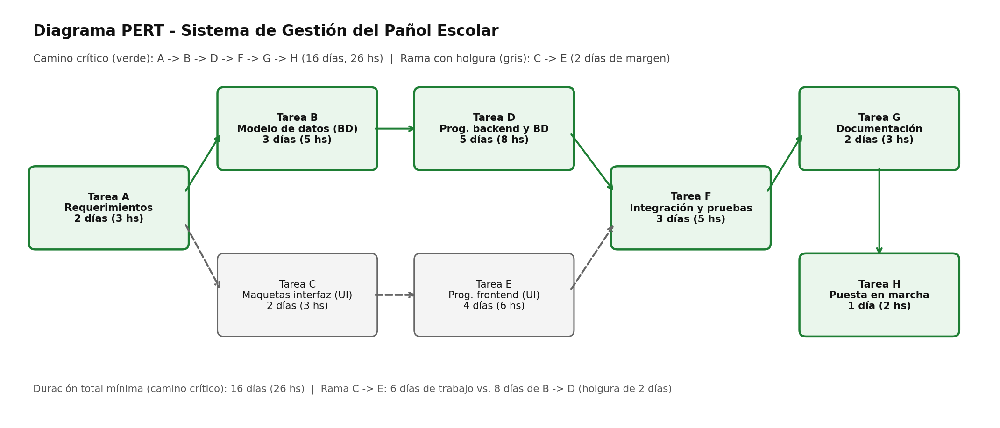
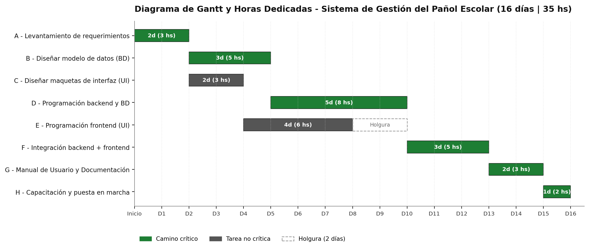

# Planificación y Control de Proyectos: Diagrama PERT y Diagrama de Gantt

**Materia:** Modelos y Sistemas (7mo Año)
**Caso de estudio:** Desarrollo e Instalación del Sistema de Gestión del Pañol Escolar
**Autor:** Franco Capria

---

## 1. Introducción a la Planificación de Proyectos

Para desarrollar un sistema en orden hace falta organizar los tiempos, la secuencia de tareas y la asignación de recursos antes de programar. Los diagramas de red y los cronogramas permiten armar un plan visual previo y controlar el avance durante el desarrollo.

## 2. Diagrama PERT

El diagrama PERT representa las actividades de un proyecto mediante una red de nodos y flechas.

* **Estructura:** Los nodos muestran cada tarea con su duración estimada y las flechas indican qué actividad debe terminar antes de iniciar la siguiente.
* **Camino crítico:** Es la secuencia de tareas dependientes más larga de la red y determina la duración mínima total del proyecto.
* **Características clave:** Muestra las holguras (margen de días que puede demorarse una tarea sin afectar la fecha final) y sirve para planificar dependencias lógicas.

## 3. Diagrama de Gantt

El diagrama de Gantt organiza las tareas sobre un calendario mediante barras horizontales.

* **Estructura:** En el eje vertical se listan las actividades y en el eje horizontal se ubica la línea de tiempo en días. Cada barra muestra cuándo empieza, cuánto dura y cuándo termina una tarea.
* **Características clave:** Brinda una vista directa del avance diario, muestra qué tareas se ejecutan en paralelo y facilita el seguimiento del equipo.

## 4. Cuadro Comparativo: PERT vs. Gantt

| Característica | Diagrama PERT | Diagrama de Gantt |
| :--- | :--- | :--- |
| Enfoque principal | Red de nodos y flechas que muestra qué tarea depende de otra. | Cronograma en el tiempo con barras horizontales de avance. |
| Identificación de prioridades | Destaca el camino crítico y las holguras de cada rama. | Muestra cómo se ubican las tareas en el calendario. |
| Uso en el proyecto | Planificar el orden de las tareas y calcular la duración mínima total. | Controlar el avance diario, las horas dedicadas y las fechas de entrega. |
| Nivel de detalle | Muestra el flujo lógico y la precedencia entre tareas. | Muestra las fechas de ejecución y las tareas en paralelo. |

## 5. Caso Práctico: Sistema de Gestión del Pañol Escolar

### Tabla de Tareas y Horas Dedicadas

| ID | Tarea / Actividad | Predecesora | Duración | Horas dedicadas |
| :--- | :--- | :--- | :--- | :--- |
| A | Levantamiento de requerimientos y entrevistas | Ninguna | 2 días | 3 hs |
| B | Diseñar el modelo de datos (Base de Datos) | A | 3 días | 5 hs |
| C | Diseñar las maquetas de interfaz de usuario (UI) | A | 2 días | 3 hs |
| D | Programación del backend y base de datos | B | 5 días | 8 hs |
| E | Programación del frontend (interfaces de usuario) | C | 4 días | 6 hs |
| F | Integración de backend + frontend y pruebas | D, E | 3 días | 5 hs |
| G | Redacción del Manual de Usuario y Documentación | F | 2 días | 3 hs |
| H | Capacitación al personal y puesta en marcha | G | 1 día | 2 hs |
| **Total** | **Totales del proyecto** | **-** | **16 días (calendario)** | **35 hs totales** |

### Consigna 1: Construcción del Diagrama PERT

* **Determinación del camino crítico:** Luego de completar la tarea A (2 días), el proyecto se divide en dos ramas paralelas antes de unirse en F:
  * Rama de Base de Datos y Backend (`B -> D`): 3 días + 5 días = 8 días (termina en el día 10).
  * Rama de Interfaz y Frontend (`C -> E`): 2 días + 4 días = 6 días (termina en el día 8).
  * Como la tarea F depende de D y E, comienza en el día 10. El camino crítico es `A -> B -> D -> F -> G -> H`, con una duración mínima de **16 días** (26 horas en esa ruta).
* **Impacto ante retrasos:** Si se atrasa cualquiera de las tareas del camino crítico (A, B, D, F, G o H), se atrasa la fecha final de entrega en la misma cantidad de días. Las tareas C y E tienen una **holgura de 2 días**, por lo que pueden demorarse hasta 2 días en conjunto sin afectar el inicio de F.

### Consigna 2: Construcción del Diagrama de Gantt

* **Organización del cronograma:** El proyecto se completa en 16 días de calendario con 35 horas totales de trabajo. Entre el día 3 y el día 8 se ejecutan en paralelo la rama de base de datos/backend y la rama de diseño/frontend para llegar juntas a la integración en el día 10.

### Consigna 3: Análisis Comparativo Aplicado

* **Utilidad del Diagrama PERT:** Permite ordenar las dependencias al inicio del proyecto e identificar que el diseño de base de datos y el backend (B y D) marcan el camino crítico de 16 días.
* **Utilidad del Diagrama de Gantt:** Sirve para el seguimiento diario sobre el calendario, mostrando el solapamiento entre ramas paralelas y las fechas límite de cada etapa.
* **Uso combinado:** PERT define la lógica de dependencias y márgenes de demora, mientras que Gantt traduce ese orden en un calendario operativo por días y horas.
